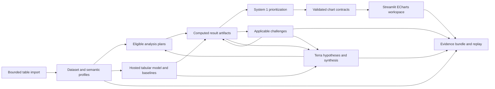

Build specification dated 20 November 2026. First Look is an open-source, Python-only Streamlit application for investigating an unfamiliar tabular dataset. It automatically connects profiling, semantic interpretation, constrained analysis, visual discovery, targeted tabular foundation-model diagnostics, and challenges to attractive findings. The result is an interactive investigation and a portable evidence package.

The core promise is to compress work that normally spans a profiling report, several exploratory notebook cells, an initial model experiment, a set of sensitivity checks, and documentation into one connected session. “10x” is the design ambition for that combined capability; it is not a measured productivity claim.

This is the execution specification for one uninterrupted build session. Implement the complete integrated workflow, tests, documentation, example datasets, API adapters and Streamlit Community Cloud configuration in that session. There is no intervening user study, screenshot review, or approval gate. The owner supplies paid-service credentials after the build.

Application logic, UI composition, provider integrations, replay tools, fixture generators and tests are Python. Normal TOML configuration, JSON schemas and data, Markdown documentation, and licensed font assets are permitted. There is no authored JavaScript or TypeScript, React application, custom frontend build, or separate web server required for deployment.

This specification supersedes conflicting implementation choices in the [earlier utility specification](https://chatgpt.com/space/page_1fe233fb9e2c819198293cd41b18122b). The [academic synthesis](https://chatgpt.com/space/page_1ef7fe0cf80c8191b32880a2fc23b869) remains its evidence foundation. Published findings, engineering defaults and product hypotheses are distinguished throughout.

# 1 People and the job to be done

The primary person is a hands-on data generalist receiving an unfamiliar dataset: an analyst inheriting a CSV, a research assistant beginning a study, a postgraduate researcher, or a community data volunteer. They understand dataframes and basic statistics, can work in a notebook, and need help choosing productive questions and identifying misleading interpretations. They value control, inspectable calculations, and an artifact another person can use.

The initial job is: “Help me understand what this table contains, discover worthwhile relationships, investigate what could mislead me, and preserve enough evidence to decide what to do next.”

| Situation | Recurring difficulty | Required value |
| --- | --- | --- |
| A colleague sends an undocumented export | Field names, numeric codes, grain and missing values need interpretation | A usable overview and editable semantic map |
| A researcher begins exploratory analysis | Many plausible plots compete for attention | A small diverse set of relevant analytical questions |
| An attractive relationship appears | Aggregation, subgroups or a few records may change the picture | Automatic applicable checks with a visible before and after |
| Marginal relationships look weak | Joint predictive structure is hard to inspect manually | A bounded model experiment that feeds new questions back into the visual investigation |
| Someone needs to share the work | Conclusions become detached from filters, transformations and methods | An evidence package with exact result tables, contexts and replay instructions |

The utility should support one person working with one table in a session. Sharing happens through exported artifacts. Contributor and teaching workflows reuse the same contracts and known-answer examples.

A completed session delivers three things: an accurate dataset brief; a small evidence-linked collection of observations, challenges and next questions; and a downloadable investigation package. Generating a large gallery of unrelated charts does not satisfy this job.

# 2 The distinctive experience

## An investigation rather than a report

After upload or example selection, First Look assembles a bounded investigation plan. It can suggest a focus field, enumerate valid analyses, compute evidence, prioritize diverse findings, run applicable challenges on the leading findings, and prepare a model lens. The person can steer the focus or correct assumptions at any point.

Automatic mode must provide meaningful results without requiring the person to formulate a predictive problem first. A suggested model target is an existing eligible field, explicitly labeled as an exploratory focus rather than a scientifically important outcome. The target, permitted predictors and evaluation assumptions are visible before the model request.

Question-directed mode accepts a question such as “Does the relationship change by group?” or “Where does the model struggle?” and translates it into a supported intent. The same contracts and calculations execute it. Unsupported requests produce a useful explanation and nearby valid options.

## The flagship session

1. Open the seeded subgroup-reversal example or a real mixed-type dataset.
2. See the dataset brief, proposed roles and initial investigation plan.
3. Correct an apparent numeric measure to an identifier. Ineligible plans disappear and dependent work becomes stale.
4. Run the investigation. A System 1 provider prioritizes eligible questions using computed evidence.
5. Open a finding. Its support, transformation, chart contract and provenance are accessible.
6. Open Challenge. Compare the pooled relationship with supported subgroup views, a distribution view or an appropriate sensitivity check.
7. Open Model lens. Evaluate the chosen focus field using held-out predictions, baselines and declared split assumptions.
8. Inspect an error-by-group or observed-versus-predicted view; use it to launch a further supported question.
9. Pin useful observations and weakened interpretations into the evidence brief.
10. Export, reopen the bundle, and replay supported outputs.

At least one full integration scenario must connect actual Jev and TabPFN adapters to the analysis and visualization contracts. During a credential-free build, verify those adapters against documented request/response contracts and controlled transports; mark live verification as pending credentials. Never report a simulated provider as a live model run.

## Capability that makes the app materially different

The leading observations are accompanied by applicable challenges, not merely a “trustworthy” badge. Model diagnostics become inputs to the same discovery engine. Every view has a reproducible analytical context. The person can follow the entire path from field interpretation to result to challenge to saved evidence.

The initial automated pass challenges up to three leading descriptive findings. It does not indiscriminately run every check or fit a model for every column. A finite budget and explicit eligibility keep the experience responsive and interpretable.

# 3 Release scope and operating envelope

## Required in the completed build

CSV and Parquet ingestion; deterministic profiling; editable semantic roles; optional dataset description; bounded candidate discovery; real Jev integration; real hosted TabPFN integration; Terra’s multimodal investigation and synthesis; native ECharts compilation; linked selections; automatic and user-triggered challenges; model diagnostics; evidence pinning; bundle export/import; Python replay; an example gallery; automated acceptance tests; and Community Cloud deployment instructions.

All of these belong to the initial integrated build. An offline descriptive path is necessary for accessibility and missing credentials, and must not be used to defer implementation of the model integrations.

## Input and resource policy

These are engineering defaults to implement and measure, not limits established by research.

| Setting | Initial value |
| --- | --- |
| Upload byte limit | 25 MiB |
| Parsed table hard limit | 50,000 rows and 80 columns |
| Deep dataframe memory guard | 80 MiB for the active table |
| Fully exercised investigation envelope | 500–20,000 rows and at most 40 analysis fields |
| Pairwise computation sample | Up to 20,000 rows, seeded and recorded |
| Model sample | Up to 10,000 labeled rows total |
| Scatterplot displayed points | Up to 5,000, sampled with stable source mapping |
| Visible discovery shortlist | Six cards initially, expandable to twelve |
| Numeric association candidates | At most 300 pairs |
| Automatic challenge budget | Top three findings, at most three eligible checks each |
| Model experiments | One focus per investigation; one explicit comparison rerun |
| Concurrent investigations per process | Two, with bounded waiting |
| Active expensive model task per session | One |

A table outside the complete-investigation envelope can still receive a bounded overview. Show which columns or rows were sampled or excluded, preserve the selection policy, and offer field selection. Sampled statistics must never appear as full-table counts.

Check upload size before parsing. Read CSV incrementally with a hard row ceiling; validate Parquet metadata and read row groups or batches rather than expanding an unbounded compressed payload. Stop on the memory or dimensional guard with an actionable message. Preserve the original bounded input bytes only when needed for export; avoid repeated dataframe copies.

## Deliberate boundaries

One flat table, supported scalar fields and one connected familiarization task. No joins, arbitrary Python execution, unrestricted SQL generation, automatic data repair, causal discovery, production prediction service, account system or persistent shared project database.

Free-text fields can contribute metadata or explicit user descriptions. Full document mining, image analysis and time-series forecasting are outside this release. A recorded time field may support descriptive temporal summaries and a later-observation evaluation split; neither makes the model a validated forecasting system.

# 4 Screens and information architecture

Use four persistent work areas: Understand, Discover, Challenge and Evidence. Keep Model lens inside Discover and accessible from relevant findings. Navigation must preserve the dataset, focus, semantic corrections, filters, jobs and pinned evidence.

## Global shell

A compact sidebar contains the wordmark, dataset name, navigation, row and field counts, active focus, provider availability, and a collapsed Settings area. Settings contain technical/provider details; ordinary analytical flows use plain labels.

The main header contains the current work-area title, one sentence explaining the next useful action, and a compact context strip: full data or selected subset, sample status, semantic revision, and model state where relevant. A visible Reset selection action clears the analytical selection context.

Use a question bar in Discover, not a chat transcript as the default interface. Suggested questions are buttons generated from eligible intents. The interface stays useful when the language API is unavailable.

## Understand

The empty state offers Upload data, three prominent example cards, and an additional gallery list. Each example explains what it is useful for investigating, without promising a predetermined favorable model result.

After import, show dataset dimensions, missingness and coverage, followed by a concise computed brief. A semantic editor displays original name, physical type, proposed role, confirmed role, units if supplied, ordinal order, exclusion status and provenance. Rare technical fields are hidden behind Inspect details.

A field inspector provides distribution, distinct values, missingness, parse evidence and representative values subject to privacy settings. Editing semantics changes interpretation, not source values. Apply edits as one validated transaction.

Below it, show an investigation plan: focus field or descriptive-only mode, proposed analyses, applicable challenge families, split policy, approximate workload and external data destinations. The main action is Run investigation.

## Discover

Start with the most useful available finding as a full-width lead card. Follow with a responsive two-column grid of secondary findings. Default six cards; Show more reveals up to twelve.

Each card contains a question-led title, one factual observation, a chart, support and missingness, evidence status, and actions: Inspect, Challenge, Pin and Why this view. Use a small consistent action set rather than a row of six competing buttons.

A source selector exposes Overview, Relationships and Model lens. A view-type or field filter refines already computed candidates without another paid model call. Include a clear “Little reliable structure found” state when appropriate.

Model lens shows the chosen task, predictors, split, resource budget, baselines, held-out diagnostics and further eligible questions. Provider failure leaves descriptive findings available.

## Challenge

Show the original finding and one active challenge side by side, stacking responsively. Keep denominators, filters, units and scale choices explicit. A comparison sentence reports the measured change, such as a correlation changing sign or the direction differing between recorded groups.

An ordered list shows applicable, completed, skipped and unsupported checks. Results use precise statuses: changed under this check, similar under this check, insufficient support, or not checked. “Passed” must not imply the interpretation is true.

Allow one additional supported check and an explicit comparison configuration. A challenge result can be pinned independently of its parent observation.

## Evidence

Show a readable outline of pinned observations, challenges, caveats and unanswered questions. Allow reorder, remove and user notes. User interpretation is visibly distinct from computed statements.

Offer Download brief, Download investigation bundle and Import bundle. A Methods panel exposes a compact provenance diagram, versions, provider decisions and replay details. Export controls explicitly choose whether to include the bounded original dataset.

An imported bundle opens in replay mode. Rendering saved results must not trigger paid calls. Recompute and Live model rerun are distinct explicit actions.

# 5 Visual design system

## Character

The app should feel like a carefully designed analytical instrument: crisp typography, calm surfaces, generous hierarchy, precise charts and minimal decorative noise. It should look complete before data is uploaded and remain coherent during partial results or provider failures.

Use native Streamlit theming and composition. No injected CSS is required for the initial design. Do not use private DOM selectors, floating HTML buttons, or a custom component framework. The installed official Streamlit skill supports responsive grids, richer theme tokens, native selection widgets and consistent chart styling. [Streamlit design guidance](https://docs.streamlit.io/develop/concepts/design/best-practices)

## Tokens

| Token | Light | Dark |
| --- | --- | --- |
| Page background | #F6F8FC | #0F1522 |
| Secondary surface | #EDF1F8 | #182235 |
| Primary text | #152239 | #E8EEF8 |
| Secondary text | #58677F | #AFBDD1 |
| Border | #D4DCE8 | #34435B |
| Primary action | #3157CE | #3157CE |
| Link | #244BB8 | #ADC4FF |
| Success text | #176C4C | #9BDFBC |
| Caution text | #865B0A | #F0CC83 |
| Changed result text | #B43945 | #FFB1B8 |

Verify text and button contrast mathematically. Preserve semantic labels and icons alongside color. The chart palette is separate from status colors; group identity must not imply good or bad.

Use locally bundled IBM Plex Sans for body and headings and IBM Plex Mono for code and identifiers, with their font licenses. Use Streamlit’s bundled sans-serif and monospace as fallbacks. Configure self-hosted fonts through fontFaces and static serving; no font CDN dependency. [Font configuration](https://docs.streamlit.io/develop/concepts/configuration/theming-customize-fonts)

Body size 16 px; headings approximately 34, 26, 21 and 18 px; metadata 13–14 px; no essential text below 12 px. Use medium heading weights and tabular-looking numerical presentation. Radius 10 px for controls and panels. Use an 8 px spacing rhythm through native gaps and spacing controls.

Use one strong accent, restrained borders, and consistent chart treatment. Avoid gradients, oversized marketing hero text, animated decoration and excessive metric cards.

## Layout and chart treatment

At wide widths, keep two comparable chart panels side by side. Use st.grid with wrapping and an appropriate minimum cell width; maintain source order. A two-column comparison should become one column before either chart becomes illegible. Horizontal toolbars wrap naturally.

Use typical chart heights of 300–340 px for cards and 380–440 px for inspection. Titles belong above plots; axes carry units; support and caveats belong immediately below. Prefer light gridlines and limited ticks. Category labels wrap or switch to horizontal orientation instead of shrinking.

Keep the first viewport useful: title, context, a lead observation or next action, and evidence status. Large raw tables and JSON inspectors start collapsed or on demand.

Use Material Symbols consistently. Primary actions are visually strong; secondary actions are quiet. Maintain focus indicators, descriptive widget labels, accessible chart names and a tabular alternative for every finding.

## Required polish states

Design explicit empty, loading, partial, complete, no-signal, selected-subset, stale, invalid-input, provider-unavailable, rate-limited and replay states. Skeletons should reserve the eventual card geometry. Show real task stages; never display a fabricated percentage.

A missing API key produces one compact capability notice and a working descriptive experience. A model exception produces an actionable message within its panel, not an application-wide traceback.

No screenshots of the live app are part of implementation or verification. Use layout contracts, token checks, DOM assertions and runtime inspection. These checks can establish structural quality and catch clipping; they do not establish a human preference rating.

# 6 Architecture and module boundaries

Use one Streamlit application process with a pure Python analytical core. Keep source data, user state and result artifacts session-scoped. External APIs supply model inference; no local deep-learning model or GPU is required on Community Cloud.



The language model can propose semantic hypotheses, parse a question into an intent, and assemble an evidence-linked brief. Its output enters validation before affecting the pipeline. It never becomes executable Python, SQL, statistics or an arbitrary chart specification.

Required packages should remain modest: Streamlit 1.67.0, pandas, NumPy, SciPy, scikit-learn, PyArrow, Pydantic, httpx, typesafe-sdk, tabpfn-client, openai and Matplotlib. Development dependencies include pytest, Hypothesis, a transport mocking library, Ruff, a type checker, psutil and Playwright for Python.

Use Python 3.12. Resolve compatible package versions at the beginning of the build, then pin them in the deployment requirements. Current tabpfn-client metadata identifies version 0.7.1 and bounded dependency ranges; respect those constraints rather than mixing unconstrained newest releases. Do not install torch, tabpfn local weights, SHAP or a heavyweight profiling framework in the Cloud dependency set. [TabPFN client package metadata](https://raw.githubusercontent.com/PriorLabs/tabpfn-client/main/pyproject.toml)

A lightweight built-in profiler is the authoritative source for the required metrics. Existing profiling tools can later be adapters, but their HTML reports must not be embedded as the app’s main experience.

## Suggested repository

```text
streamlit_app.py
firstlook/
  config.py
  contracts.py
  state.py
  ingest.py
  profiling.py
  semantics.py
  discovery.py
  ranking.py
  investigation.py
  challenges.py
  modeling.py
  jobs.py
  evidence.py
  replay.py
  providers/
    base.py
    typesafe.py
    tabpfn.py
    language.py
  visualization/
    rules.py
    compiler.py
    selection.py
    templates.py
    review_assets.py
  ui/
    shell.py
    components.py
    understand.py
    discover.py
    challenge.py
    evidence.py
  resources/
    rules.json
    research.json
examples/
tests/
scripts/
docs/
static/
.streamlit/
  config.toml
  secrets.toml.example
requirements.txt
requirements-dev.txt
pyproject.toml
README.md
LICENSE
THIRD_PARTY_NOTICES.md
```

Thin page scripts may live in app_pages if st.navigation is used. The entrypoint initializes configuration, state and navigation; analysis modules never import Streamlit. Avoid a separate package for every small function. The boundaries above identify responsibilities, not a requirement for excessive abstraction.

# 7 Versioned contracts

Define Pydantic models with explicit enums, finite-number validation, bounded string lengths, JSON-safe serialization and forbidden unknown fields where appropriate. Use schema_version = 1 for the initial artifact family. Contract validation happens on import, provider output, analysis creation, compilation and bundle import.

| Contract | Essential fields |
| --- | --- |
| DatasetRecord | Fingerprint, original byte hash, parser configuration, dimensions, row identity mapping, source description and artifact version |
| DatasetProfile | Full-table counts, per-field summaries, parse evidence, sampling references and quality flags |
| SemanticProfile | Field IDs, physical types, role hypotheses, active roles, scale, units, order, exclusion, source and confirmation state |
| AnalysisContext | Dataset and semantic revisions, selected row IDs or filter expression, focus, sampling policy and assumption declarations |
| AnalysisPlan | Stable ID, question, catalog operation, field IDs, typed parameters, eligibility evidence, context hash and expected outputs |
| ResultArtifact | Plan ID, context hash, result table references, computed statistics, support, exclusions, warnings and method version |
| Finding | Question, claim type, result references, factual statement tokens, ranking dimensions, limitations and available challenges |
| DecisionRecord | Provider, requested and resolved model if available, state hash, exact options and order, response, distribution, policy result and usage |
| ChartSpec | Result reference, template, encodings, transforms already applied, units, scales, missing policy, selection map, applied rules and text alternative |
| ModelRun | Focus and predictors, preprocessing, split memberships, sample, seeds, parameters, baselines, metrics, prediction tables and provider metadata |
| ChallengeResult | Parent finding, check plan, original and alternative contexts, measured differences, support and bounded status |
| EvidencePacket | Matched result references, exact values, plotting data, review assets, context and remaining budget |
| HypothesisProposal | Question, evidence references, allowed operation, typed arguments, missing assumptions and abstention |
| EvidenceRelation | Validated or proposed relationships between findings, contexts and completed checks |
| NarrativeSynthesis | Verified observation blocks, model interpretation, unresolved questions and provenance |
| InvestigationBundle | Manifest, contracts, result files, provenance, notes, checksums, environment and replay instructions |

Field IDs are stable internal identities independent of editable display names. Original column labels are preserved, including duplicates resolved through a documented internal-name mapping. Source row IDs come from file fingerprint and original row position; the dataframe index is not a business key.

Use content hashes for analysis identities. Include dataset identity, semantic interpretation, filters, focus, algorithm version, sampling, parameters and model settings. Navigation or opening a panel does not create a new analytical context.

Store tabular outputs as bounded result artifacts. A ChartSpec references those outputs; it does not contain an opaque dataframe or a large arbitrary JSON object. Rehydrate the dataframe source at rendering time. Exported chart options use JSON-compatible saved values or references resolved by the replay tool.

A Finding can only cite values present in validated result artifacts. Generate its numerical text from named value tokens and shared formatting functions. If a prose model supplies a new number or unsupported direction, reject that sentence and use a deterministic template.

# 8 Ingestion profiling and semantic interpretation

## Ingestion

Support one UTF-8 or UTF-8-with-BOM CSV with configurable delimiter and an explicit encoding override where needed, plus scalar-column Parquet. Display parser settings. Reject duplicate or malformed headers only when they cannot be mapped safely; otherwise preserve an explicit original-to-internal mapping.

Do not silently drop malformed rows. Report parsing errors with bounded examples and a correction path. Do not silently collapse zero, empty strings and strings such as NA into one missing category. Declare and record the missing-token policy and preserve parse-failure evidence. Do not claim to recover distinctions that the source format does not encode.

Reject unsupported nested columns with a clear field list. Do not accept pickle, executable objects or arbitrary remote URLs. An imported investigation bundle follows the validated bundle path, not the table parser.

## Required profile

For all fields: physical dtype, nonmissing and missing counts, distinct count, uniqueness ratio, constant status, representative values and memory footprint.

For numerical fields: finite and nonfinite counts, min, max, selected quantiles, mean, median, standard deviation, IQR and a bounded histogram. Report zero-variance cases explicitly.

For categorical fields: frequency table, missingness, rare levels and coverage of any top-N display. Never combine an Other category without recording membership and its count.

For potential dates: parse success, observed range, timezone evidence and observed coverage. Do not assume that an absent timestamp means a zero measurement.

At table level: dimensions, exact duplicated-row count under declared equality, candidate keys and row-grain uncertainty. Candidate keys are evidence about uniqueness, not verified domain identifiers.

## Numerical conventions

Use linear-interpolated quantiles, sample standard deviation with ddof = 1, unweighted means unless a weight is explicitly supported, pairwise finite rows for correlations and average ranks for tied Spearman values. Store the method with each result.

A zero denominator yields an unavailable value with a reason, never a fabricated zero. Distinguish whole-table support, paired support and group support. Combined proportions use combined numerators and denominators rather than an unweighted mean of rates.

Keep naive timestamps naive unless a timezone is supplied. Record timezone conversion, period boundaries and aggregation explicitly. Descriptive time charts leave unobserved periods missing unless the data establishes a zero.

## Semantic roles

Use: measure, categorical dimension, ordered category, timestamp, identifier, free text, boolean and unknown. Keep physical type, semantic role and analytical eligibility separate.

Rules first propose plausible roles. A numeric column with high uniqueness or code-like values can be an identifier hypothesis; a date-like name is evidence rather than permission to coerce every value. Combine field context and supplied descriptions through the language adapter when enabled. Jev chooses among constrained plausible hypotheses, including unknown.

Retain proposed and user-confirmed states. Automatic roles can enable safe descriptive views under visible assumptions; unsupported roles cannot enable sums, temporal continuity or a predictive target. Never infer a currency, causal role, unit conversion, domain denominator or ordered scale without evidence.

The editor validates contradictions: an identifier cannot simultaneously be a summable measure; ordinal encodings require an explicit order; unit-incompatible fields cannot silently share an axis. Correcting one field invalidates only dependent plans, charts, model inputs and decisions.

Context-sensitive typing research motivates this combination of signals and uncertainty; it does not verify arbitrary scientific definitions. [Sherlock](https://vis.csail.mit.edu/pubs/sherlock/), [Sato](https://arxiv.org/abs/1911.06311), [Doduo](https://arxiv.org/abs/2104.01785)

## Investigation plan

Build an inspectable plan from active roles and user focus. Include eligible plan counts, excluded fields with reasons, automatic challenge budget, a proposed model target where possible, the proposed split and external payload categories.

Dataset descriptions and representative values are untrusted data, not instructions to the application or a provider. Place them in clearly delimited fields and do not give the language model external tools, code execution or filesystem access.

# 9 Discovery catalog and ranking

Compute bounded candidates in code before model prioritization. Record the candidate family searched, its sampling and exclusions. The initial catalog is deliberately understandable and extensible.

| Family | Eligibility and calculation | Finding and chart |
| --- | --- | --- |
| Numeric distribution | Eligible measure with finite values; quantiles and shared histogram bins | Shape, range, concentration and extremes; histogram or ECDF |
| Category frequency | Dimension or boolean; exact counts and coverage | Common and rare recorded levels; sorted horizontal bars |
| Missingness | Full-table missing counts and supported group comparisons | Missing-value concentration or differences; bars or a bounded heatmap |
| Numeric relationship | Two measures; at least 30 paired finite observations | Pearson and Spearman summaries with support; scatterplot |
| Grouped distribution | Dimension and measure; bounded groups with support | Median, mean, dispersion and counts; boxplot or dot comparison |
| Category relationship | Two bounded dimensions and adequate cell support | Recorded frequency structure; count or proportion heatmap with explicit denominator |
| Temporal summary | Valid timestamp, measure and a declared aggregation | Observed change and coverage; time line with gaps |
| Model diagnostic | Completed valid ModelRun | Held-out fit, residual structure and group errors; reused chart templates |
| Data-quality trap | Identifier, constant, duplicate, missingness or target redundancy evidence | A precise caution and its supporting table or chart |

A high-cardinality dimension is not automatically reduced to a handful of “important” groups. Offer top-N with explicit coverage or require a narrower selection. Keep all filters typed and reproducible.

## Candidate selection

Use separate normalized dimensions: evidence support, descriptive magnitude, focus relevance, diversity and redundancy. Reliability issues are flags and eligibility gates, not a hidden scalar that claims truth.

An initial engineering policy can use a deterministic utility of 0.35 magnitude rank, 0.25 support, 0.25 focus relevance and 0.15 coverage, followed by a redundancy penalty up to 0.30. These weights are configuration defaults to evaluate, not academic constants. Normalize magnitude within a family before comparing different statistics.

Jev can provide rubric-based relevance and choose a coherent next view from valid candidates. When unavailable or uncertain, use deterministic ranking. Provider confidence is neither a p-value nor the probability that a finding is true.

Use greedy diversity selection: avoid filling the shortlist with the same field pair, metric and aggregation. Aim to cover distribution, relationship, grouped behavior and a relevant quality issue where candidates exist. Do not fill an empty slot with an unsupported observation.

Default candidate limits: 300 numeric pairs; group candidates over at most ten eligible dimensions and the most relevant measures; category-pair candidates over at most twenty bounded pairs. Record truncation. Use seeded samples for expensive screening and exact bounded recalculation for selected findings where feasible.

Support is visible. A large effect in a tiny group cannot outrank support requirements through fluent explanation or model preference.

Search and recommendation research informs bounded discovery and diversity. Its usefulness measures do not transfer automatically to this app. [SeeDB](https://www.vldb.org/pvldb/vol8/p2182-vartak.pdf), [Foresight](https://arxiv.org/html/1707.03877), [Voyager 2](https://idl.uw.edu/papers/voyager2)

## Statistical language

The initial discovery feed is exploratory and descriptive. It does not rank uncorrected p-values or claim statistical significance for selected winners. Track the whole searched family so later inferential extensions have provenance.

Use language such as “in these rows,” “associated,” “differs between recorded groups,” and “worth checking.” An observed correlation, a resampling result or held-out prediction cannot establish a causal effect.

# 10 The challenge engine

A challenge is an executable analysis plan with explicit prerequisites, not a second model opinion about the same chart. Code determines applicability. Jev may prioritize among applicable checks.

| Check | Trigger | Computation | Bounded conclusion |
| --- | --- | --- | --- |
| Subgroup comparison | Numeric relationship and a supported dimension | Compare pooled and group correlations, directions and supports | Relationship differs by recorded group, or insufficient support |
| Distribution behind an average | Group summary | Add medians, quartiles, counts and distributions | Mean comparison hides variation or changes with summary |
| Extreme-value sensitivity | Association or summary with sufficient rows | Recompute with a declared extreme-value exclusion; retain original | Result changes under this exclusion |
| Rank versus linear relationship | Eligible numeric pair | Compare Spearman and Pearson with the same paired rows | Dependence on the chosen association summary |
| Missingness composition | Eligible finding with missing paired values | Compare observed composition and missingness by recorded groups | Analyzed rows have different recorded composition |
| Bin or aggregation sensitivity | Histogram or temporal summary | Compare a small predeclared set of bins or time aggregations | Apparent pattern depends on this display or summary choice |
| Split and predictor sensitivity | Valid model lens | Inspect split memberships and redundancy; allow one explicit alternative run | Evaluation changes under this split or predictor set |
| Error concentration | Held-out predictions and supported groups | Compare group error with support and a global reference | Model errors differ across these recorded groups |
| Resampling stability | Exchangeable-row assumption explicitly declared | Recompute a fixed statistic over seeded resamples | Variation under this resampling procedure |

Use minimum support defaults of 30 paired rows for an association and 20 observations per displayed group for automatic group comparisons. For subgroup-reversal candidates, require at least two supported groups. Expose these defaults in Methods; they are not universal scientific thresholds.

Automatic checks share fixed definitions, budgets and candidate logs. A sensitivity exclusion uses a declared rule, such as outside the 1st–99th percentiles for that field pair. Call it a sensitivity view, not cleaned data. Retain excluded row IDs and counts.

For an initial association subgroup search, evaluate at most three eligible dimensions, with at most eight displayed levels each. Report which dimensions were checked. A discovered reversal is an exploratory conditional pattern, not proof of confounding or a causal mechanism.

Resampling uses 100 seeded replicates for the initial diagnostic budget. Do not label its range as a confidence interval by default. If exchangeability is unknown, offer a noninferential sensitivity check or explain why the resampling option is unavailable. Grouped or temporal data require an appropriate unit or procedure; do not silently resample rows.

Use four result statuses: similar under this check; changed under this check; insufficient support; not checked. Store the measured quantities and comparison policy behind each status. Never display a universal robustness score.

The engine must preserve a finding that weakens or disappears. Pinning an original without its completed contradictory challenge should display a nearby caveat in the brief. Multiple-comparison and adaptive-analysis research motivate this restraint and the search log. [Visual multiple comparisons](https://cs.brown.edu/research/ptc/assets/publications/zgraggeninvestigating.pdf), [Adaptive holdout reuse](https://arxiv.org/abs/1506.02629)

# 11 Contractual chart compilation

The chart compiler consumes a validated ChartSpec and a ResultArtifact. It applies a finite template catalog and produces a Python ECharts option dictionary. The analytical result is computed upstream and shared by chart, text, table and export.

Initial templates: sorted horizontal bars, category dot comparison, histogram, ECDF, scatterplot, grouped boxplot, time line and heatmap. Model diagnostics reuse these templates. The initial catalog omits elaborate chart families without imposing a universal ban on their legitimate use.

## Required ChartSpec

Include chart ID and revision; question and analytical task; result ID and context hash; field-to-channel encodings; units and formatted labels; explicit aggregation; scale type and domain policy; missing-value treatment; category order and top-N coverage; sample status; legend policy; support; selection mapping; accessible summary; and applied validity and preference rule IDs.

Hard constraints reject unsupported fields, missing prerequisites, inconsistent units, invalid aggregation, nonfinite plotted values, inappropriate log domains, stale results and unsupported series. Soft preferences choose among valid alternatives.

Examples of executable rules:

- Identifiers cannot become summable measures by being numerically encoded.
- Bars comparing magnitudes use a zero baseline.
- Log scales require positive values and a visible scale label.
- Ordinal categories preserve their declared order.
- Line charts require an ordered axis and do not silently connect absent periods.
- A proportion carries its numerator, denominator and conditioning direction.
- Aggregated chart marks map to the rows or exact selection predicate that produced them.
- Top-N truncation includes coverage and a defined Other policy.
- Paired challenge views use comparable domains where they ask the same comparison; label a deliberate domain change.
- Small differences do not acquire exaggerated prose through a truncated quantitative axis.

Few’s design advice informs preferences and examples. Task-based graphical-perception work informs the conditions under which encodings help. Draco motivates explicit constraints; neither authorizes treating all preferences as universal facts. [Draco](https://idl.uw.edu/papers/draco), [Task-dependent effectiveness](https://idl.uw.edu/papers/task-data-effectiveness), [Few’s public library](https://www.perceptualedge.com/library.php)

## Native integration

Render with st.echarts_chart on Streamlit 1.67. Use dataframe-backed dataset.source for tabular series. The native integration supports declarative options and selection events, with no JavaScript formatter functions, custom renderItem series, registered-map/geo rendering or ECharts GL.

Normalize selection groups by series identity and map indices against that exact result revision. Indices can survive specification changes; never apply them blindly to new data. Store application selections separately from the read-only chart event state. [Native ECharts API](https://docs.streamlit.io/develop/api-reference/charts/st.echarts_chart)

A selection first previews matching rows and support. Apply selection commits a new analytical filter context and updates linked panels. This prevents an accidental brush from launching paid calls or creating a filter feedback loop. Reset selection restores the parent context.

Use chart keys stable within a result revision and mapping hash. A changed mapping creates a new chart identity and clears stale selection. Handle a brush that hits zero points distinctly from no active brush.

No client-side data transform may obscure source-row mapping. Precompute bins, summaries and grouping in Python. Support both direct-row selection and aggregate-to-predicate mapping.

Why this view explains its question, transformation and actual rules in plain language, followed by an optional contract inspector. A valid alternative encoding can be selected without recalculating the underlying result.

# 12 System 1 decision integration

Use the official TypeSafe service and typesafe-sdk. The verified API is POST https://api.typesafe.ai/v1/systemone. Do not substitute similarly named unofficial Jev sites or use an invented decide endpoint.

The Python client exposes TypeSafeClient.system_one with typed Choice, Score and Noul questions. Questions in one request are evaluated independently against the same state. Compose dependencies in code rather than assuming one answer conditions another. [Official quickstart](https://docs.typesafe.ai/introduction/quickstart), [Official Python SDK](https://github.com/typesafe-ai/typesafe-sdk-python)

## Required decisions

1. Choose among plausible field roles generated upstream, including unknown.
2. Judge the relevance of already computed candidates to the stated focus.
3. Choose an applicable next challenge from code-approved options, including none suitable.

Use stable option IDs and short, precise descriptions. Supply field metadata, supplied context, verified result summaries, support and limitations. Exclude raw records and representative values by default; an explicit disclosure policy can add bounded examples.

Prefer atomic Choice or short-rubric questions over a single request to “decide the whole analysis.” Batch independent questions sharing the same state. Candidate-specific judgments must identify the candidate and its computed evidence clearly.

Validate that response IDs, selected option IDs and distributions match the request. Reject nonfinite values, negative probabilities, absent required options or malformed totals. Preserve the raw validated response and any provider confidence separately from the application decision.

## Abstention and control

An unknown or none-suitable option is always available where interpretations may be unsupported. Code enforces hard eligibility regardless of the winning choice.

An initial acceptance policy may require selected-option probability at least 0.75 and a margin of 0.15 over the runner-up; otherwise retain the deterministic alternative or ask for an in-app semantic correction. These are conservative engineering defaults, not validated calibration thresholds. Keep them configurable and report their behavior in the benchmark.

Do not multiply a confidence number into a statistic or call the result “insight confidence.” Display a model preference only in the decision inspector. Users primarily see the actual evidence and caveats.

Recent independent Jev studies motivate checks for ordering effects, irrelevant context, rubric compression, calibration and abstention. They are early evidence about specified versions and tasks, not proof of chart-selection quality. [Independent benchmark](https://arxiv.org/abs/2609.37647), [Bias evaluation](https://arxiv.org/html/2610.19619v1), [Ordinal scale study](https://arxiv.org/html/2609.38827v2)

## Provider states

Support configured, unavailable, unauthorized, rate-limited, timed-out and invalid-response states. Bounded retries apply only to transient failures and must not bypass the request budget. A failed call yields a labeled deterministic decision; it never leaves half-updated semantic state.

Log the exact request options, ordering, requested model alias, resolved model if supplied, prompt version, response, latency, usage and policy outcome. Do not invent chain-of-thought or explanations absent from the provider response.

# 13 Tabular foundation model lens

## Deployment choice

Use hosted TabPFN through tabpfn-client as the required foundation-model backend. Community Cloud hosts the Python UI and analysis; Prior Labs hosts the model computation. The official client provides a familiar classifier/regressor interface and noninteractive token authentication.

This replaces the earlier local-default TabICL choice because the deployment environment has shared, variable resources. Keep the backend interface compatible with a later local or remotely hosted TabICL adapter, but do not make that additional deployment a prerequisite for this release.

Use tabpfn-client 0.7.1 if it resolves with the chosen lock. Its documented submit_fit, wait_for_fit, submit_predict and wait_for_predict operations support asynchronous server work. A saved model record can be retained as a JSON-safe dictionary; do not load pickle artifacts. Standard mode is the initial default; thinking mode is outside the automatic pass because of its longer, separate workload. [TabPFN client](https://github.com/PriorLabs/tabpfn-client), [Async jobs](https://docs.priorlabs.ai/capabilities/async-jobs)

## Eligibility and focus

Support numeric regression and categorical classification with 2–20 observed classes, adequate support and a provider-supported schema. Default minimum 200 labeled rows. For random classification splits, require at least 20 observations per class and sufficient training and test support. Other splits must independently satisfy class support.

Never target an identifier, free-text field, constant, automatically derived row number or unsupported role. Do not impute missing target values. Record how many rows are excluded because the focus is missing.

Suggest a focus using semantics, user intent and suitability. Do not search all targets and present the highest held-out score as if it were a prespecified benchmark. The person can choose another eligible field.

## Predictors and leakage checks

Build an explicit allowlist. Exclude the target, identifiers, exact target copies, source row IDs, user-excluded fields, and confirmed post-outcome or target-component fields. Flag suspicious deterministic transformations and almost-exact target relations.

Some leakage is domain-dependent and cannot be certified away from values alone. Show unresolved warnings next to the predictor list. A high score cannot suppress them.

Raw permitted predictor and target values are sent to the TabPFN provider. The execution plan must disclose that boundary and require the dataset user’s in-app choice to enable external modeling. This is an app interaction, not a required review during implementation.

## Evaluation protocol

Use one recorded split for all candidate models and baselines.

- Random held-out rows: seeded 70/30 split, stratified when appropriate. If independence is unknown, label this a row-holdout diagnostic with limited generalization claims.
- Group holdout: distinct groups cannot appear on both sides. Exclude the grouping identifier from predictors by default.
- Time holdout: earlier observations train, later observations test; do not shuffle. Preserve ties at the boundary and report coverage.
- If declared structure conflicts with the split or adequate support is unavailable, block that experiment with an explanation and an applicable alternative.

Sample before splitting under a recorded policy that preserves the chosen evaluation meaning. For a time split, retain chronological coverage; for a group split, sample whole groups under the budget. Record exact original-row membership, not only a seed.

Fit each model’s preprocessing on training rows only. Use numerical imputation and categorical encoding appropriate to that model. Unknown test categories have an explicit handling policy. The TabPFN adapter may preserve supported categorical values; its transformation manifest still records every change.

Compare TabPFN with a dummy predictor, a regularized linear or logistic baseline, and a bounded histogram gradient-boosting baseline. These are fixed-budget references, not exhaustive tuning. Limit threads and encoded dimensions; use one deterministic seed and record parameters.

For regression show MAE, RMSE and R-squared with support; R-squared can be negative. For classification show balanced accuracy, macro F1 and log loss when a valid aligned probability matrix is available. Do not force one universal “model score.”

Validate prediction shape, row order, finite values, class ordering and probability totals. All diagnostic tables use held-out predictions. Training residuals cannot appear as independently evaluated evidence.

## Discovery outputs

Create typed findings for observed versus predicted, residual distribution, absolute error by supported group, classification confusion and class probability diagnostics. For weak marginal structure, compare the model with baselines before suggesting joint predictive structure.

A residual is not an anomaly probability. Error concentration is not evidence of a group’s causal influence or a fairness guarantee. The first release does not label SHAP or permutation importance that it has not actually computed.

The model lens can propose a new descriptive check on a supported field or error group. Record this as adaptive exploration. Repeatedly inspecting a holdout prevents treating every later question as a fresh confirmatory test.

The model may lose to a baseline. Preserve that result and make it understandable. Benchmark literature supports evaluating the method under its own protocol. A Nature result on an earlier TabPFN version does not validate the current hosted version on this app’s datasets. [TabPFN research](https://doi.org/10.1038/s41586-024-08328-6), [TabArena](https://arxiv.org/abs/2506.16791), [TabReD](https://arxiv.org/abs/2406.19380)

# 14 Terra visual reasoning and grounded investigation

Use GPT-6.1 Terra through the OpenAI Responses API as the multimodal investigation and synthesis layer. It proposes new questions, compares related views, recommends executable challenges and revises an explanation after code computes the checks. This replaces the earlier gpt-5.4 language-adapter default. The detailed research, contracts and tests are in [Terra integration](../research/terra-integration.md).

Terra complements profilers, Jev and tabular foundation models. Profilers provide measured evidence; Jev chooses among eligible alternatives; tabular models provide held-out predictive diagnostics; Terra generates and connects hypotheses and explanations. Jev also accepts images, so visual input alone is not the distinction. [Terra model](https://developers.openai.com/api/docs/models/gpt-6.1-terra), [TypeSafe images](https://docs.typesafe.ai/images)

## Research based role

LIDA and Data Formulator 2 motivate staged goal generation and iterative investigation. DePlot motivates keeping numerical evidence available with visual reasoning. Chart-to-Text and ChartQAPro demonstrate why fluent chart explanations and benchmark capability cannot substitute for checked facts. [LIDA](https://aclanthology.org/2023.acl-demo.11/), [Data Formulator 2](https://www.microsoft.com/en-us/research/publication/data-formulator-2-iteratively-creating-rich-visualizations-with-ai/), [DePlot](https://aclanthology.org/2023.findings-acl.660/)

The integration is an engineering hypothesis to evaluate on this app’s tasks. Terra does not become the source of statistics or causal conclusions.

## Bounded loop

After initial discovery and Jev prioritization, Python assembles an EvidencePacket with exact metrics, bounded plotting data, context, supported operations and up to three chart assets. Terra proposes up to three hypotheses. Code validates them, Jev may prioritize, and at most two additional cheap checks execute within the shared budget.

A second Terra request synthesizes the new evidence. Stop after that cycle; additional user-directed work consumes the existing follow-up allowance. The initial cap is three Terra calls total, including an optional metadata/semantic call and any repair attempt. Do not add a separate autonomous agent framework.

Use the existing model experiment rather than fitting a foundation model for each proposed question. Duplicate plans reuse existing results.

## Questions and analytical extensions

QuestionIntent retains known field IDs, grouping/time fields, allowed aggregates, typed filters, challenge type and clarification state. Reject invented fields, unsupported roles, invalid denominators and causal requests that the table cannot answer. Never execute generated Python, SQL or ECharts JSON.

Add quantile_bin_summary and residual_spread_by_bin to make visual shape hypotheses actionable. The former records bin boundaries, medians, quartiles and support; the latter uses an existing held-out ModelRun with predictor-bin boundaries learned from training rows. These are descriptive checks, not causal or calibrated uncertainty claims.

## Visual assets without screenshots

Do not capture the live app. Generate offscreen PNG assets in Python from validated chart/result contracts, using Matplotlib Agg and explicit Figure objects. Preserve units, domains, bins, source mappings and sampling metadata. This is an analytical review view, not a pixel-equivalent audit of native ECharts.

Limit assets to three per packet, 1.5 MiB each, a 1,200-pixel long edge and at most 600 plotted observations per review view. Supply the exact same plotting data with the images. Serialize rendering, close buffers, and re-measure Cloud memory.

## Grounded synthesis

Add EvidencePacket, HypothesisProposal, EvidenceRelation and NarrativeSynthesis contracts. Proposals remain hypotheses until checks execute. Numerical observations and registered directional statements bind to result artifacts; Python renders verified values.

Terra can generate explanatory prose and connect views. Keep that interpretation distinct from measured findings. A citation, schema-valid output or Jev agreement does not prove an unrestricted sentence is entailed. Reject unsupported quantities, invented units and causal assertions in factual blocks.

Show what was observed, what was checked, what remains a hypothesis and what to do next. Preserve weakened findings and context differences in both the interface and export.

## Failure and evaluation behavior

Keep structured controls, deterministic summaries and all completed evidence available when Terra is missing, refuses or fails. Placeholder keys cause no request. Record packet/asset hashes, prompts, model identity, outputs, accepted/rejected proposals and usage for replay without API calls.

Compare the existing system, Terra with tables/contracts only, and Terra with the identical tables plus images. Test executable follow-ups, supported claims, abstention, null cases, presentation sensitivity and cost. Known-answer oracles take precedence over model grading. Ship the evaluation harness now; live comparative results wait for the owner’s API key.

# 15 Orchestration jobs caching and state

## Session state

Initialize a WorkspaceState once. It holds a cryptographically random session token, dataset reference, semantic revision, active context, focus, navigation, job references, finding shortlist and evidence outline.

Separate durable analytical state from widget state. Hiding a widget or changing views must not discard a semantic correction or pinned finding. Changes to the table, semantic assumptions, filters or model settings produce a new context revision. Navigation and display preferences do not.

Keep old pinned artifacts immutable. If their source interpretation changes, label them as belonging to an earlier context and offer a new calculation; never silently rewrite an exported observation.

## Computation graph

Define task dependencies explicitly: import → profile → semantics → eligible plans → computed candidates → prioritization → charts and challenges; a model run depends on dataset, roles, focus, predictors, split and settings.

An invalidation function computes affected task IDs. Rename-only display changes need not refit a model if field identity and data are unchanged; unit or role changes invalidate affected analytical meaning.

Deduplicate tasks by context hash, provider, operation, parameters and attempt identity. No paid request may be launched merely because a page reran, a tab opened or a polling fragment ticked.

## Job controller

Use a small bounded ThreadPoolExecutor or equivalent Python controller for API waits and bounded analysis tasks. Worker code returns plain result objects and never calls Streamlit or mutates Session State.

Maintain job states: queued, running, completed, failed, cancel-requested, cancelled and stale. Access to job records requires both job ID and owning session token. Admit at most two active investigations per process and one expensive model task per session.

Use a polling fragment to read task progress and publish completed results on the main app path only when context and attempt IDs still match. A result for an earlier target or dataset is discarded or retained as a prior artifact, never installed as the current result.

Cancel prevents queued work and detaches from in-flight results. It cannot guarantee cancellation of a remote provider’s billable work. Do not claim otherwise. Set finite transport, provider-polling and application deadlines; a timed-out waiter must not start the same remote fit again automatically.

TabPFN wait methods can block a worker, not the Streamlit render thread. Store accepted remote job/model IDs or saved records before waiting. Do not infer that an unconfirmed submit failed and immediately duplicate it.

Clean expired results and input references on completion and activity-triggered housekeeping. Community Cloud process restarts can lose session jobs; it is not a durable queue.

## Caching

Use Streamlit data caching for public examples and static research/rule resources. Use resource caching for owner-configured reusable API clients and the bounded job manager, with thread-safety constraints.

Keep uploaded data and private result caches inside the session artifact store. Bound it by retained contexts and bytes; clear unused artifacts on dataset replacement. Do not put user data into an unscoped global cache keyed only by filename or public dataset hash.

Keep one active table and references rather than repeated filtered copies. Cache calculations by context where beneficial; cheap display transformations should not become a sprawling cache hierarchy.

Use fragments for independent panels and progress polling. Parallel fragments are limited to independent work with controlled state access, not shared dataframe mutation. Keep slow work outside hidden tabs and collapsed inspectors unless their visibility is tracked. [Fragment reference](https://docs.streamlit.io/develop/api-reference/execution-flow/st.fragment)

## Budgets and failures

Initial per-investigation upper bounds: four batched Jev calls including prioritization of valid Terra proposals; three Terra requests including optional semantic interpretation, a proposal request and a synthesis request; one TabPFN fit and one prediction job. Terra can add at most two cheap checks after the ordinary automatic challenge pass. Repair attempts consume the same request cap. Question-directed follow-ups have a visible bounded session allowance. An explicit model comparison run consumes an additional declared budget.

Show actual counts and provider-reported usage. Only show a money estimate when a versioned quote or pricing source supports it. Respect Retry-After, use bounded backoff, and never retry authorization errors.

Process-local limits reset on restart and are not hard billing protection. The owner must configure spending and quota controls in provider accounts. Keep this setup instruction precise; do not add a commercial account system to the utility.

# 16 Evidence export import and replay

## Human brief

The brief includes dataset identity and supplied context; active semantics; selected findings with support; completed challenges and changed interpretations; model task, split and baselines where present; limitations; user notes; and next questions.

Keep computed observations, model-derived observations and user interpretation visually distinct. A model result is described using its recorded evaluation context. A user note cannot become a computed finding through export.

## Bundle layout

```text
manifest.json
dataset/
  schema.json
  provenance.json
  original.csv or original.parquet     optional
profiles/
  dataset.json
  semantics.json
analysis/
  contexts.json
  plans.json
  findings.json
  challenges.json
  decisions.json
model/
  runs.json
  predictions.parquet
tables/
  result_<id>.parquet
charts/
  contracts.json
  options.json
brief.md
notes.json
environment.json
checksums.json
REPLAY.md
```

The export is generated from the same validated artifacts used by the interface. Include all referenced result tables and a manifest of completeness. Missing or failed analyses have explicit status, never an empty success file.

No secrets, bearer headers, cookies or raw exception payloads belong in the bundle. Provider request logs honor the chosen disclosure policy. Do not describe a metadata-only bundle as anonymous: field names, categories, aggregates and model outputs can remain sensitive.

A data-free bundle supports inspection and rendering of saved results. Computational replay requires the exact original data, verified by fingerprint. Raw-data inclusion is an explicit export control.

## Replay levels

1. Inspect and render saved artifacts without API calls.
2. Recompute supported deterministic analyses from the exact data and pinned environment.
3. Explicitly re-execute models as a new run, using currently configured credentials.

Saved hosted decisions are enough to replay the recorded application path. They do not guarantee independent live re-execution. Record requested aliases, resolved model identity when supplied, client versions, seeds, memberships and outputs. Mark unavailable version information as unknown rather than inventing a checkpoint.

Offer a Python CLI such as python -m firstlook.replay inspect bundle.zip and python -m firstlook.replay recompute bundle.zip --data original.csv. It invokes the same allowlisted analytical functions as the app.

## Safe import

Validate archive entry names, path traversal, absolute paths, symlinks, entry count, compressed and expanded byte budgets, schema versions, referenced IDs and checksums. Import only expected artifact formats. Do not execute archived Python, notebook cells, pickle, shell commands or arbitrary query strings.

Validate types and references before displaying imported claims as supported app artifacts. Label imported provenance as recorded information; a checksum detects changes but does not establish authorship or scientific correctness.

Reopening a bundle reconstructs context and evidence without silently sending its data externally. Unsupported versions open a clear compatibility message rather than partial corruption.

# 17 Configuration API placeholders and Cloud deployment

## Required secret template

Ship .streamlit/secrets.toml.example with these placeholders. The owner copies the content into Community Cloud Secrets or a gitignored local secrets.toml.

```toml
[providers]
typesafe_api_key = "REPLACE_WITH_TYPESAFE_API_KEY"
typesafe_model = "jev-latest"

tabpfn_token = "REPLACE_WITH_TABPFN_TOKEN"
tabpfn_model_path = "auto"

openai_api_key = "REPLACE_WITH_OPENAI_API_KEY"
openai_model = "gpt-6.1-terra"
openai_reasoning_effort = "medium"

[app]
provider_mode = "auto"
allow_external_analysis = true
max_concurrent_investigations = 2
max_model_rows = 10000
max_session_followups = 5
terra_visual_review = true
max_terra_loop_requests = 2
max_terra_initial_requests = 3
max_terra_images = 3
max_terra_plot_points = 600
max_terra_packet_chars = 48000
```

The application maps these fields to SDK configuration. TypeSafe uses TYPESAFE_API_KEY conventionally; the client also accepts explicit configuration. TabPFN’s documented token name is TABPFN_TOKEN and set_access_token is available. Set the owner’s token once for the process, not a different global token per visiting user. OpenAI receives the explicitly configured key.

Placeholder strings and empty strings count as unconfigured. Never attempt a request with them. Do not include an actual secrets.toml in Git. Environment variables can supply local equivalents, with documented precedence.

provider_mode supports auto, offline and live. Auto uses configured capabilities; offline prohibits all provider requests; live reports missing providers explicitly and still preserves usable completed work. Fixture transports are test-only and cannot be selected by public widgets.

Requested aliases such as jev-latest and auto may change. Record what the service reveals about the resolved model. A configurable alias is not a pinned checkpoint.

## Community Cloud package

Deploy a normal Python Streamlit app from a GitHub repository, root entrypoint streamlit_app.py, Python 3.12 and pinned requirements.txt. Use repository-relative assets. Community Cloud initializes from the repository root. [Cloud limitations](https://docs.streamlit.io/deploy/streamlit-community-cloud/status)

The production config enables headless operation and static font serving, sets the upload limit, defines the complete theme and disables usage telemetry where the public setting supports it. Keep XSRF and CORS protections at their supported defaults. Never enable the development agent API in committed production config.

Do not add Docker, a FastAPI server, Redis, a database or a GPU runtime. A public community utility should remain easy to clone and launch.

Community Cloud documents shared limits that may change and lists approximate historical ranges rather than a permanent guarantee. The architecture therefore avoids local foundation-model weights, bounds data and concurrent work, and treats local disk as temporary. [Cloud resource guidance](https://docs.streamlit.io/deploy/streamlit-community-cloud/manage-your-app)

## Owner setup after completion

Document three accounts and credentials: TypeSafe, Prior Labs and OpenAI. Document required provider quota or access, API model configuration, provider-side spending limits and the exact secret-field mapping.

Provide a Python provider preflight that reports configured, authenticated, unsupported model, quota unavailable or transport failure without printing credentials. A minimal paid smoke is explicit and bounded. Credential setup should require configuration and rerunning this script, not changing source code.

Provide a deployment checklist for selecting repository, branch, entrypoint, Python version and Secrets. The build is complete with deployment-ready code and clear setup; actual Cloud publication and authenticated paid checks cannot be claimed before credentials and deployment access exist. [Cloud secrets](https://docs.streamlit.io/deploy/streamlit-community-cloud/deploy-your-app/secrets-management)

# 18 Research registry and executable design rules

Ship a small research registry alongside executable rules. Each record includes source title and URL, evidence type, supported finding, conditions, limitation, implementation rule, fixture and test ID.

Use evidence types: empirical task study, systems evaluation, predictive benchmark, methodological result, design guidance, vendor interface documentation and engineering hypothesis. Do not collapse these into one “validated” label.

The initial implementation must connect at least these patterns to behavior:

| Rule family | Pattern | Anti pattern | Required evidence in the app |
| --- | --- | --- | --- |
| Semantic interpretation | Propose context-sensitive roles and permit correction | Treat physical type as verified meaning | Role provenance and uncertainty |
| Analysis eligibility | Validate complete typed plans | Combine independently plausible but incompatible field choices | Eligibility reasons and rejection fixtures |
| Chart selection | Match task, data and encoding | Claim a universal best chart irrespective of task | Question, applied rules and alternatives |
| Visual honesty | Preserve quantities, denominators and context | Exaggerate through unsupported aggregation or scale | Shared result artifact and explicit scale |
| Discovery | Bound search and reduce redundant views | Optimize chart count or selected p-values | Candidate-family and exclusion log |
| Mixed initiative | Let the person steer and revise | Produce an uneditable automatic report | Editable semantics and question-directed follow-up |
| Challenge | Execute relevant alternative views | Replace checking with a confidence badge | Comparison quantities and bounded status |
| Predictive evaluation | Match split to the intended diagnostic | Use training residuals or random splits indiscriminately | Memberships, preprocessing and baselines |
| Decision models | Ask atomic questions with abstention | Assume confidence equals correctness | Actual distributions and policy outcome |
| Reproducibility | Preserve data, decisions, settings and results | Export a narrative without analytical context | Bundle and independent replay |

The accompanying research appendix contains primary links and conditions. Existing Few indexes in the repository should be preserved as research artifacts, not treated as an exhaustive machine-validated rule corpus.

No human study is required before this build completes. Human interpretation and task-effectiveness studies justify mechanisms and evaluation dimensions; they do not substitute for user evidence about this particular interface. The initial release reports automated results and reserves claims about experienced productivity or preference for actual later evidence.

# 19 Example datasets and known answer fixtures

Bundle small licensed real datasets and seeded synthetic datasets with provenance, checksums, descriptions and redistribution notices. Keep examples small enough to work within the Cloud envelope and useful without keys.

## Real examples

Palmer Penguins demonstrates mixed measurements, recorded groups and missingness. UCI Bike Sharing uses the daily table to demonstrate temporal coverage, split choices and target-component redundancy. The Palmer Penguins data are distributed under CC0; UCI lists Bike Sharing under CC BY 4.0. Preserve the dataset citations and license notices, and pin the downloaded files. [Penguins data license](https://github.com/allisonhorst/palmerpenguins#license), [Bike Sharing license](https://archive.ics.uci.edu/dataset/275/bike+sharing+dataset). Do not claim either dataset supplies causal ground truth.

Dataset download failures must not prevent the app starting. Store permitted example files in the repository after verification rather than relying on a live URL for each session.

## Synthetic fixtures

- Subgroup reversal: construct a known pooled direction opposite to supported within-group directions. Assert the actual generated statistics and challenge behavior.
- Joint nonlinear structure: include a target with joint predictive signal and weak marginal association. The fixture defines the signal; it does not guarantee TabPFN beats every baseline.
- Independent variables: enough support to demonstrate restraint. The app may show distributions, but must not fabricate a strong relationship or inferential conclusion.
- Numeric identifiers and codes: enforce semantic and aggregation restrictions.
- Missingness concentration: exact known counts and group composition.
- Sparse and constant fields: no divide-by-zero, false correlation or misleading filled chart.
- Target redundancy: include an exact target copy and confirmed target components; verify exclusion and warnings.
- Group and time leakage: make split membership failures observable.
- Unicode, duplicated labels and long categories: preserve identity and readable output.
- Stale context: swap data, focus or semantics while a model job is pending; the old result must not become current.

Every synthetic example has a deterministic Python generator and metadata describing what is known. Tests should verify properties, not merely snapshot whatever the implementation happens to output.

The gallery includes negative outcomes. A fixture that correctly yields insufficient support, a baseline win or a weakened finding is a successful demonstration of the utility.

# 20 Verification without screenshots or user testing

Execute meaningful automated checks during the build. Do not use screenshots, image snapshots, screenshot-based visual regression, browser video or traces configured to capture screenshots. Python Playwright can inspect DOM state, bounding boxes, accessibility labels, interactions and console errors without image capture.

## Numerical and contract tests

Use hand-computable examples for exact counts, means, quantiles under the chosen definition, group denominators, missingness and source-row mappings. Compare selected analytical outputs with independent pandas, NumPy or SciPy calculations.

Property-based tests cover finite outputs, row-order invariance where appropriate, compatible-unit transformations, missing-value policies, unsupported role rejection, stable identities and deterministic sampling.

Compile each supported chart template from a valid contract. Reject invalid scale domains, stale result hashes, inconsistent units, unsupported series, missing support and invalid selection maps. Verify that displayed numbers, tables and export values come from the same result artifact.

Do not test only that functions return their own expected dictionary shape. Test known quantities and invalid analytical interpretations.

## Provider tests

Use controlled HTTP transports or stub SDK boundaries for success, partial failure, authorization failure, rate limiting, timeout, refusal, malformed distributions, class-order mismatch and unsupported model settings.

Verify exact payloads and response normalization against official interfaces. Test that independent Jev questions are not treated as dependent decisions. Permute option presentations, then map results back by option ID in evaluation code.

Test TabPFN submission and resumed waits, accepted job identity, shape validation, row alignment and class alignment. Verify no duplicate fit occurs on polling, navigation or ordinary reruns.

Never use a fixture model response as evidence of real model accuracy. Ship live smoke and evaluation scripts that activate only with valid credentials and explicit live mode.

## Streamlit and browser tests

Use AppTest for navigation, semantic edits, focus changes, filters, pinning, notes, provider notices, missing-key startup and bundle workflows. Chart browser behavior needs a real renderer; AppTest does not natively drive chart selection. [AppTest limitations](https://docs.streamlit.io/develop/concepts/app-testing/cheat-sheet)

Run a headless Streamlit instance and inspect its agent API on a development-only port. Read the running OpenAPI schema before issuing interactions; use supported request fields. Check ready/error status, widget state and server warnings. This verifies the real runtime without a screenshot. [Agent access](https://docs.streamlit.io/develop/concepts/ai-agents/agent-access)

Use Playwright for Python for actual ECharts selection, reset, modal or dialog flows, file upload/download and responsive layout. Derive any mouse coordinates from element bounding boxes and declared chart geometry, never from screenshots.

Test wide desktop, small laptop and narrow mobile viewports. Check that principal panels and actions remain within their containers, cards wrap, important labels remain visible, keyboard navigation reaches primary actions, and charts and tables have accessible names. Verify light and dark token application and compute palette/text contrast in Python.

DOM checks cannot establish that a chart is aesthetically pleasing. The exact design system, consistent component implementations and structural assertions are the available safeguards under the no-screenshot constraint.

## Reproducibility and performance

Export a known investigation, import it into a fresh session, and compare contexts, claims and result tables. Recompute supported deterministic outputs in a fresh process from the same data and locked environment. Use exact comparisons for integers and documented tolerances for floating point.

Benchmark import, profile, candidate calculation, compilation, baseline modeling and export on a named machine. Measure peak process RSS and repeated-run growth. Test two simultaneous sessions for separation and bounded resource use.

Target a useful initial overview within five seconds and a complete bounded descriptive pass within fifteen seconds on a declared two-core reference configuration, excluding cold application startup and external APIs. These are build targets to measure and tune. Publish actual measurements if the available machine differs.

Target peak RSS below 600 MiB for the documented representative workload. If measurements exceed the budget, reduce retained copies, samples or concurrency and update the documented envelope. Do not hide resource failures by silently dropping analyses.

External model latency, availability, spending and substantive model quality remain unverified until real credentials are configured. Report that separately from passed offline checks.

# 21 Build execution sequence

Work through these stages in one session. Each stage produces usable artifacts and automated evidence. Do not pause for an external user study, screenshot review, or additional scope discussion.

1. Inspect the repository, preserve the existing research artifacts, confirm Python and Streamlit versions, read the installed official skill references needed for the work, and resolve a compatible dependency lock.
2. Establish configuration, placeholder secrets, contracts, session state and the visual shell. The app must start with no API keys and show a polished example-selection state.
3. Implement bounded ingestion, profiling, semantic rules and the editor. Build known-answer fixtures immediately around substantive calculations and role restrictions.
4. Implement one integrated vertical slice: one relationship candidate, one live-ready Jev decision, one chart contract, one subgroup challenge, one hosted-model adapter path, one diagnostic finding and evidence export.
5. Complete the bounded discovery catalog, ranking and automatic challenge pass. Add the remaining chart templates using the shared compiler.
6. Complete model eligibility, splits, baselines, diagnostics and stale-job handling. Test controlled provider responses and failure paths.
7. Add Terra’s bounded hypothesis/check/synthesis loop, matched review assets, the two declared shape/error checks, question-directed intents and evidence-linked brief assembly. Keep every path usable without language assistance.
8. Complete the four work areas, responsive grid, linked selection preview/application, Why this view, model lens, evidence outline and all partial/error/replay states.
9. Implement safe bundle import, deterministic replay and CLI tools. Run a fresh-process replay.
10. Complete real examples, synthetic fixtures, research/rule registry, license notices, provider setup, launch and Cloud instructions.
11. Run numerical, contract, provider, state, AppTest, agent API and browser checks without screenshots. Fix failures and inspect console warnings.
12. Run performance and isolation checks, tighten the operating envelope if measured limits require it, and publish an honest completion report with remaining credential-dependent checks.

## Implementation priority when tradeoffs are necessary

Preserve the integrated investigation, both model adapters, meaningful challenges, evidence linkage, replay and polished core screens.

Reduce the number of secondary chart variants, optional inspector conveniences or redundant example walkthroughs before weakening analytical correctness. Do not deliver a profiler with model features deferred to an unspecified later phase.

Avoid infrastructure work that does not directly support the flagship session. No account management, plugin marketplace, generalized agent framework, remote GPU deployment or collaborative editing is needed.

Maintain a build checklist with checkboxes tied to test IDs and files. Mark a feature complete only when its real code path exists and the appropriate available checks pass. Record a credential-dependent live check as pending, not completed by a mock.

# 22 Completion criteria and handoff

The final handoff contains the working Python app, pinned deployment dependencies, complete source, tests, licensed examples, API placeholder template, research and rule registry, replay tools, benchmark report and Community Cloud setup instructions.

Acceptance requires:

- A clean checkout can install documented dependencies and start the app without secrets.
- The flagship workflow runs end to end with deterministic analysis and controlled provider transports.
- Real Jev, hosted TabPFN and GPT-6.1 Terra adapters are implemented against official interfaces, including matched visual evidence packets and bounded follow-up proposals.
- Semantic correction invalidates dependent analyses; malformed contracts cannot render.
- Every displayed numerical statement resolves to an artifact with matching context and support.
- Automatic challenges can weaken a finding, and that result remains visible and exportable.
- Model diagnostics use held-out rows, compare baselines and expose split and predictor restrictions.
- Linked selection uses correct source mappings and does not launch paid work accidentally.
- Missing keys, failed requests, cancellation, stale jobs and imported bundles have complete UI states.
- Fresh-session import and fresh-process deterministic replay succeed.
- Meaningful tests pass; runtime warnings and resource measurements are reported.
- No live-app screenshots were taken, and no claim of user testing is made.
- Credential-dependent and deployment-dependent checks are identified explicitly.

The owner’s remaining actions are service account setup, filling the documented secret values, setting provider quotas, and deploying the prepared repository. Those actions should not require redesigning the app.

Community value should ultimately be observable in repeated use on different datasets, understandable challenges, successful independent replay and useful contributions. The build can establish correctness and readiness now; it cannot honestly manufacture evidence of a tenfold human productivity improvement.
