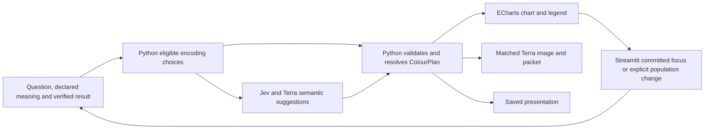

# Strategic chart colour for First Look

Status: proposed architecture, 24 November 2026. This investigation covers the current Python v2 implementation, Jev, Terra, TabPFN, Apache ECharts and native Streamlit 1.67.0. It defines the next implementation; it does not record a completed runtime change.

Colour should help a person connect evidence, compare quantities and follow a question. Introduce one small, shared colour policy between calculated evidence and its renderers. Keep ordinary views useful immediately, with neutral defaults and automatic choices where meaning is established. Add no palette picker, colour setup page or compulsory metadata task.

## Research and its implications

Few distinguishes grouping, attention and quantitative encoding, and treats the background and mark geometry as part of colour perception. Broad fills can use softer colours than thin lines or small points. Non-data scaffolding should recede. His examples also show that increasing line width or point size can improve visibility without increasing saturation. These principles support a role-aware policy rather than replacing the application's existing palette with another list. [Few, Practical Rules for Using Color in Charts, 2008](https://www.perceptualedge.com/articles/visual_business_intelligence/rules_for_using_color.pdf), especially pages 1, 4–7 and 10–12.

The ggthemes implementation supplies Light, Medium and Dark variants of the same eight non-gray hue families, plus gray. Its suggested Light-for-fills convention and Few's medium-bar examples are compatible when geometry, context and contrast determine the final variant. They are not evidence that every bar must be pale or every line maximally saturated. Exact source values are recorded below. [ggthemes Few palette](https://jrnold.github.io/ggthemes/reference/few_pal.html), [palette source](https://github.com/jrnold/ggthemes/blob/main/data-raw/theme-data/few.yml).

ColourBrewer separates qualitative, sequential and diverging schemes. A diverging midpoint must correspond to something meaningful in the data; the observed numerical midpoint alone is insufficient. [ColourBrewer scheme guidance](https://colorbrewer2.org/learnmore/schemes_full.html).

Crameri, Shephard and Heron show how uneven gradients can create apparent boundaries and obscure variation. Their scientific colour-map work strengthens the requirement to check ordered lightness, colour-vision deficiencies and the rendered gradient. A familiar palette name does not establish perceptual uniformity, and a numerical colour scale does not establish the importance of an observed pattern. [The misuse of colour in science communication, Nature Communications 11, 5444, 2020](https://doi.org/10.1038/s41467-020-19160-7), [author's scientific colour-map resources](https://www.fabiocrameri.ch/colourmaps/).

These are design foundations, not a measured claim that the proposed implementation improves First Look's users' performance. Product decisions below synthesize those foundations with this application's contracts and native rendering boundary.

## What the current implementation already does and where it falls short

| Location | Current behaviour | Consequence for this proposal |
| --- | --- | --- |
| `firstlook/charts.py` | One eight-colour palette; fixed colours for some marks and defaults for others | No shared distinction between broad fills, lines, points and attention |
| Grouped scatter and distribution lines | Sorted full-source category positions select a palette entry | Already consistent across filters of an unchanged upload; make that identity mapping explicit and shared rather than treating it as a current filter bug |
| Group colour lookup | Uses modulo indexing, although current eligibility bounds grouped views | Remove silent recycling as a fallback; overflow needs a different presentation strategy |
| Calendar heatmap | Observed min/max and a two-stop blue scale | No semantic reference, shared comparison scale or explicit visual status for missing cells |
| Treemap | No explicit semantic colour allocation | Default per-node colours can imply distinctions the application has not defined |
| `firstlook/perspectives.py` | Small multiples already reuse one colour; ranked measure panels use a different hue for each measure | Preserve the first behaviour; remove the second unless cross-panel measure identity actually needs it |
| `firstlook/providers.py` | Terra's independent Matplotlib image uses hard-coded blue and a default scatter cycle | A hue can mean something different in the analytical image and the user's ECharts view |
| `.streamlit/config.toml` | Separate application palettes for light and dark appearance | Theme lists cannot encode per-view group identities, centres, missingness or mark geometry |
| `firstlook/ui.py` | Native ECharts with default Streamlit theme; spatial view uses `st.map`; no persistent chart selection | Keep native rendering; introduce explicit focus semantics before linking selections to other evidence |
| `firstlook/session.py`, `firstlook/evidence.py` | Evidence identities and saved snapshots, but no resolved colour plan | Preserve numerical identities and add presentation metadata alongside them |

## One contract between meaning and rendering

Use a Python `ColourIntent` and a resolved, versioned `ColourPlan`. These are presentation contracts attached to verified evidence. They must not grant analytical permissions, change result arithmetic or modify the immutable source.

Separate **encoding** from **attention**. A chart can encode group identity and focus one group at the same time. A heatmap can encode quantity and outline a selected cell without changing its quantity colour.

| Contract | Minimum contents |
| --- | --- |
| Intent | Encoding role: neutral, nominal, ordinal, sequential or diverging; exact source field/result IDs; the analytical reason; optional focus IDs; optional reference with its unit and authority |
| Resolved plan | Policy version; evidence IDs; hue-family assignments or quantitative colour stops; numeric domain/reference/normalization; missing/status treatment; mark-role variants; focus and redundant cues; background; legend wording and decision provenance |

Use existing field and record identities. Category identity uses a canonical value associated with its field and dataset, not its display position or a truncated label. Distinguish an actual category named “Missing” from the missing-value sentinel. Allocate from the full relevant category domain once when identity encoding is needed; preserve assignments across sorting, filtering and adjacent views. Additional levels must not reassign existing colours or silently wrap around the palette. A replacement upload is a new investigation; this proposal does not promise identity reconciliation across unrelated files.

Keep a colour registry inside the investigation state, scoped by dataset and field. Allocate at most the finite identity budget; do not create thousands of hue entries for high-cardinality identifiers. Persist resolved plans with retained views so later policy updates cannot silently recolour an old record.



The initial chart need not wait for model suggestions. Existing deterministic information resolves it immediately; asynchronous integrated reviews can suggest a useful next emphasis. Jev and Terra remain always-on analytical instruments without becoming dependencies for choosing a safe default colour.

## Palettes and surfaces

Use the supplied neutral surface tokens: canvas `#EFEFEF`, analytical panel `#FFFFFF`, header background `#CCCCCC` and focus/text `#4D4D4D`. Gray header is a background, not small text on white. Use thin, quiet scaffolding; avoid decorative gradients, shadows, gloss and three-dimensional effects. A quantitative gradient across marks is different from decorative shading inside a single bar.

Recommend one validated light analytical appearance for this uplift. Consistent white chart backgrounds make colour interpretation and exported evidence easier to match. Streamlit can own the application canvas, widget surfaces, dataframe header and typography. ECharts must explicitly own its white plot surface and chart-local styles. Native `st.container` has no arbitrary background-colour parameter in the installed version; do not invent one to force white application cards. The white analytical panel can be the chart itself. A separately designed dark scheme would require its own contrast and gradient checks; changing the app appearance must not silently alter the meaning of a saved chart.

### Categorical hue families

These are the exact ggthemes values, not newly generated approximations:

| Family | Light | Medium | Dark |
| --- | --- | --- | --- |
| Gray | `#8C8C8C` | `#4D4D4D` | `#000000` |
| Blue | `#88BDE6` | `#5DA5DA` | `#265DAB` |
| Orange | `#FBB258` | `#FAA43A` | `#DF5C24` |
| Green | `#90CD97` | `#60BD68` | `#059748` |
| Pink | `#F6AAC9` | `#F17CB0` | `#E5126F` |
| Brown | `#BFA554` | `#B2912F` | `#9D722A` |
| Purple | `#BC99C7` | `#B276B2` | `#7B3A96` |
| Yellow | `#EDDD46` | `#DECF3F` | `#C7B42E` |
| Red | `#F07E6E` | `#F15854` | `#CB2027` |

Use medium fills for ordinary categorical bars where necessary, light fills for secondary large areas with adequate boundaries, and darker variants for narrow lines and small points. Prefer fewer, clearly separable families before using the whole set. Preserve the **hue family** across representations; the exact RGB can change deliberately with mark geometry. Legends must show the actual rendered variant. Gray is principally context, scaffolding and neutral data, not a ninth ordinary group slot.

Palette membership is not an accessibility certificate. On white, calculated sRGB contrast is approximately 3.36:1 for `#8C8C8C`, 8.45:1 for `#4D4D4D`, 2.67:1 for Medium Blue, 6.49:1 for Dark Blue and only 2.10:1 for Dark Yellow. Medium Blue bars can need a visible boundary; Dark Yellow is not automatically suitable for a thin essential line. Use a darker approved variant, an adequate stroke, a larger mark and redundant identity cues where needed. A derived variant must be labelled as an adaptation, not another original Few colour.

WCAG requires that colour not be the sole means of conveying necessary information. Essential graphical distinctions generally need 3:1 contrast against adjacent colours, with contextual exceptions; ordinary text generally needs 4.5:1. This does not mean every pair of neighbouring continuous-ramp stops must have 3:1 contrast. Use boundaries, labels, line styles, shapes and a readable table as appropriate. Inspect actual rendering, including anti-aliasing and opacity. [Use of colour](https://www.w3.org/WAI/WCAG22/Understanding/use-of-color.html), [non-text contrast](https://www.w3.org/WAI/WCAG22/Understanding/non-text-contrast.html).

### Sequential and diverging defaults

Adopt two auditable ColourBrewer baselines rather than maintaining a palette gallery. The source supplies discrete stops; rendering a continuous gradient between them requires additional validation. [Official scheme values](https://github.com/axismaps/colorbrewer/blob/master/colorbrewer_schemes.js).

**Sequential, low to high: Blues-9**

```text
#F7FBFF #DEEBF7 #C6DBEF #9ECAE1 #6BAED6 #4292C6 #2171B5 #08519C #08306B
```

Use a zero lower bound for a nonnegative ratio quantity when zero is part of the intended comparison, such as recorded counts. Do not force a zero baseline on every interval measure. Lighter means lower; darker means higher. Zero is a real value and uses the first stop, not the missing style.

**Diverging, below reference to above reference: PuOr-11**

```text
#7F3B08 #B35806 #E08214 #FDB863 #FEE0B6 #F7F7F7 #D8DAEB #B2ABD2 #8073AC #542788 #2D004B
```

Orange/brown means below the reference; purple means above it. Neither means good or bad. The midpoint is `#F7F7F7`. Use zero for a verified signed difference or declared meaningful zero, and a declared/computed reference for a benchmark comparison. Negative observations alone do not justify divergence: Celsius temperatures, for example, need not be a deviation from a meaningful zero.

For reference `c`, choose common bounds `[c-M, c+M]`, where `M` is the greatest absolute deviation across the evidence being compared. This makes equal numerical departures use equivalent positions on the two arms. It does not prove equal perceptual salience across different hues. Do not silently use observed min/max `[-2, 8]` with a centred three-colour gradient: its neutral colour would mean 3, not 0. An intentionally asymmetric scale needs explicit stop positions and a labelled reference.

Keep a constant-valued result constant: show its single value and a meaningful legend, rather than manufacturing a varying scale by adding one to the maximum. For all-zero deviations, show the neutral centre with “all observed differences are zero.” The policy must handle all-missing results without a numerical colour scale.

A future perceptually optimized continuous lookup table can replace these baselines under a new policy version. Validate monotonic lightness within each arm and colour-vision simulations; do not describe an RGB interpolation or a home-made ramp as experimentally validated or exactly perceptually uniform. Preserve source attribution and review reuse licences when packaging palette assets.

See the [palette reference](assets/colour-reference.svg). It illustrates the source stops and mark-role principle; it is not a certification that every colour works for every geometry.

## Deterministic policy

1. Start neutral. If position, length, facet titles or direct labels already communicate the distinction, extra hue needs a separate linking purpose.
2. Use nominal hue for genuine category identity; use ordered intensity for an ordered numerical quantity or explicitly ordered levels. Do not sort category colours by a measured outcome and imply a permanent hierarchy.
3. Require an explicit numerical reference and unit for divergence. A derived difference supplies its own reference; other business thresholds require known meaning or a human declaration. Never infer desirability from sign.
4. Resolve domains across related views together. Comparable panels share units, transformations, reference and numerical colour bounds. Independent per-panel normalization must be an explicit different question, not a rendering default.
5. Keep missing, unobserved, invalid and not-applicable states separate from numerical values. Where the engine only knows “missing,” use that label; do not invent a reason. Render a non-numeric status layer with a boundary/pattern and a legend entry. True zero remains numerical. Do not use the diverging neutral centre as the missing indicator.
6. Attention is separate from encoding. A neutral bar can become dark gray; a group-coloured line retains its hue and gains width/dash/direct label; a quantity-coloured heatmap cell retains its fill and gains an outline. Focus must not rewrite the colour scale.
7. Treat eight non-gray hue families as a ceiling, not a target or proof of readability. Practical simultaneous line limits can be lower. No modulo recycling, random colours or unannounced pooling into “Other.”
8. When identity exceeds that budget, prefer a focal group against neutral context, facet into purposeful small multiples, or ask for an explicit population restriction. Rank bars in one colour when the task is ranking. A treemap requires valid nonnegative part-whole semantics and a useful area-based overview; cardinality alone cannot select it.
9. Keep transformations and clipping analytical. No hidden log scale, per-panel quantile stretching or outlier clipping to make the colours more interesting. An allowed transformation is recorded in the definition and legend; a colour plan cannot authorize it.
10. Separate group identity from population identity. In a selected/reference comparison, retain the same group hue; distinguish populations with panel position, labels and line/outline style rather than doubling the hue count.

The numeric domain belongs to the relevant analytical scope, not automatically the entire raw dataset forever. A deliberately changed investigation can resolve a new domain with a visible legend. A linked comparison must resolve one shared domain before either panel is rendered.

## Responsibilities across the system

| Component | Responsibility | Boundary |
| --- | --- | --- |
| Python and profilers | Identify roles/support, compute categories/domains/status, validate references, choose variants, check contrast, resolve the shared plan | Exact arithmetic and policy stay here; observed values cannot establish business desirability |
| Human | Supply consequential domain meaning or choose an investigative focus | No colour setup or obligatory metadata questionnaire |
| Jev | Judge narrow semantic facts about the supplied question/context and eligible alternatives | Does not count groups, compute limits, choose RGB, invent thresholds or grant permission |
| Terra | Relate the question to evidence, propose useful emphasis/alternative views and explain consequential choices; inspect a matched analytical image | Does not infer meaning from unexplained hues, establish facts from a visual impression or emit executable styling |
| TabPFN | Supply verified predictive outputs and held-out error/residual evidence for a deliberate diagnostic | Prediction evidence is input to colour policy; the model does not define favourable outcomes or paint its own successes |
| ECharts | Draw the compiled plan, maintain local hover states, show legends and expose supported selections | Browser-only visibility changes do not alter Python's analytical population |
| Streamlit | Own native application theme, adjacent layout, persistent actions/state and model-job scheduling | A global theme palette cannot replace a per-result semantic scale |

### Jev instructions and decision logic

Use the installed TypeSafe guidance: models provide judgments; code maps them to actions. Structured state should contain the actual question, exact named candidate and supplied supporting context. Questions are independent. [TypeSafe state documentation](https://docs.typesafe.ai/concepts/state.md), [installed agent skill](../../.agents/skills/typesafe-ai/SKILL.md).

Useful atomic questions include “Does the analyst's question ask to compare East with the other regions?” and “Does the supplied note describe zero as the benchmark for this difference?” Python resolves “East” against real category IDs and validates whether a difference actually exists. It should not ask Jev whether eight is greater than the palette budget, whether a colour is dark enough or whether a row is missing.

Reuse the existing question/review boundary. Centralize question text and decision criteria with the provider adapter. Retain an unresolved case for ambiguous judgments; an API error is a service error, not a negative answer. Probability thresholds need application-specific evaluation and must not turn an inferred business reference into a human declaration.

| Established inputs | Code outcome |
| --- | --- |
| Explicit human-selected focus with valid IDs | Apply attention cues without changing the population |
| Group comparison is relevant, identity helps and cardinality is within the supported budget | Use stable hue families plus redundant cues |
| Group comparison is relevant but identity exceeds the budget | Use focus/context or a valid faceted alternative; retain all records unless the person filters |
| Ordered magnitude is the colour dimension and no meaningful centre is established | Resolve a sequential scale over an honest domain |
| Verified deviation or an authoritative reference is established | Resolve a diverging scale with that centre |
| Meaning remains unresolved or proposed emphasis adds no useful distinction | Keep a neutral or existing valid plan and offer one consequential clarification if needed |

### Terra instructions and visual reasoning

Add a bounded `presentation` object to the existing packet: encoding role, field IDs, exact active category-to-colour meaning, numeric legend/domain/reference, status meaning, committed focus, visible population and policy version. Include only the active bounded mapping rather than the entire registry.

Generate Terra's offscreen image from the same plan and calculated table as ECharts. Keep the current image/table identity checks, and add the presentation identity. Match mark colours, legend, numeric normalization and focus state. It remains an independently rendered analytical image, not a live-app screenshot. If the adapter cannot reproduce the relevant view honestly, use its supported table evidence and identify the limitation rather than sending a misleading image.

Prompt requirements: respect supplied colour semantics; never equate red with bad or gray with missing without an explicit legend; propose emphasis using real field/category/result IDs; distinguish an exploratory focus from a confirmed anomaly; explain trade-offs in ordinary language; request a missing consequential reference rather than invent one. A suspected unusual group can be investigated, but calling it an established anomaly requires a computed criterion. Model agreement is not validation of that criterion.

Transient mouse hover does not change the reasoning packet or start another review. A committed analytical focus can enter the next existing review context when it changes the question being discussed. A purely decorative change does not need another paid call.

Extend Terra's existing structured response with an optional bounded encoding/focus proposal using supplied candidate IDs. Jev's typed judgments feed the deterministic decision table above. Neither returns arbitrary chart options. This uses the current automatic review rather than introducing a second colour-review agent or a model request for every visual change.

## ECharts and Streamlit implementation boundary

Retain native `st.echarts_chart`, not a new custom frontend. ECharts supports explicit mark styles and continuous/piecewise `visualMap` mappings; compile them from the resolved plan. Specify the intended dimension and series explicitly. Theme defaults are useful fallbacks, but exact per-mark assignments and per-result domains belong in the option. [ECharts styles](https://echarts.apache.org/handbook/en/concepts/style/), [visual mapping](https://echarts.apache.org/handbook/en/concepts/visual-map/).

ECharts gives explicit `itemStyle`/`lineStyle`/`areaStyle` higher priority than `visualMap` from v5 onwards. A generic neutral fill must therefore not be applied to a quantitatively mapped heatmap series: it can disable the scale. Choose one fill authority. Define hover/selection outlines without replacing mapped fills. [ECharts migration guide](https://echarts.apache.org/handbook/en/basics/release-note/v5-upgrade-guide/).

For treemaps, set semantic node IDs and explicit colours at the intended hierarchy level. ECharts offers `colorMappingBy: "id"` for stable updates, but renderer-local identity does not replace a cross-chart registry or saved plan. Suppress uncontrolled per-item cycling and automatic saturation/alpha variations unless they encode an explicitly defined quantity. [ECharts treemap reference](https://github.com/apache/echarts-doc/blob/master/en/option/series/treemap.md).

Streamlit 1.67.0 accepts JSON-compatible options, selection events, SVG/canvas renderers and an accessible `alt`. It does not accept arbitrary JavaScript callbacks. Point/brush events require selection configuration in the spec; validate returned series-local indices against stable source identities before committing focus. [Native ECharts API](https://docs.streamlit.io/develop/api-reference/charts/st.echarts_chart).

The installed Streamlit theme reference specifies that `chartSequentialColors` and `chartDivergingColors` each require exactly ten colours, while ECharts **does not read** `chartDivergingColors`. Keep explicit per-chart scales as the authority, using the full nine/eleven source stops or a validated lookup table. A ten-stop global fallback, if configured, is a separately resampled fallback and must not truncate the source ramp or lose its midpoint. Native map markers have a separate colour adapter. [Streamlit configuration](https://docs.streamlit.io/develop/api-reference/configuration/config.toml).

Keep `theme="streamlit"` for native typography/layout defaults, with an explicit complete colour plan for each supported renderer. Preserve the existing square scatter grid overrides. Do not assume changing the theme fixes a series-level hard-coded colour. Browser download of SVG/PNG is separate from a server-side image API; the native call does not return image bytes to Python.

Use ECharts local emphasis for immediate inspection, with defined styles that preserve value encodings. Persistent focus is a Streamlit state action. Legend hiding, `dataZoom` and an interactive `visualMap` slider can change what is visible without recalculating Python summaries. Disable legend deselection and quantitative range dragging by default in evidence views; if later exposed, identify them as visibility controls. Actual filtering must use an explicit analytical action that recomputes memberships and definitions. Local hover is not cross-chart brushing; linked evidence requires validated selection state and a rerender.

ECharts provides ARIA descriptions and decal patterns, but native accessibility still requires meaningful labels, direct identity cues and tables. Check the installed wrapper's pattern rendering with the actual supported series before depending on decals. Do not make a pattern-dependent design contingent on undocumented callbacks. [ECharts accessibility](https://echarts.apache.org/handbook/en/best-practices/aria/).

## Rules for existing chart families

| View | Ordinary encoding | Focus or comparison |
| --- | --- | --- |
| Ranked categories and missingness bars | One neutral fill; labels identify categories | Dark gray focal bar with explicit label; different hues only for genuine cross-view group identity |
| Histogram | One neutral/soft fill; position and height carry interval and frequency | Outline selected intervals; never alternate bin colours or recolour by frequency without a separate reason |
| Frequency polygon and quantile curve | One sufficiently visible line; grouped distributions use stable hue families | Shared bins/domains; population distinguished with dash/panel position |
| Box summaries | Quiet fill and visible border/median; group hue only when it links evidence | Preserve the distribution summary while outlining the selected group |
| Scatter | One visible point style; genuine group hue when it answers the question | Same family across views; shape/outline or a labelled overlay for focus. Record display reduction; do not misrepresent all-source support as selected plotted records |
| Time line/bar | One colour per actual series, never a new colour per timestamp | Mark geometry sets intensity. Signed deviation heatmaps may diverge at verified zero; a negative slope alone is not a negative quantity or a bad result |
| Calendar heatmap | Sequential for level, diverging for an established departure | Shared scale and unit across comparisons; separate missing/unobserved cells; selection changes the outline, not fill |
| Categorical small multiples | Reuse one fill when panel titles already identify groups | Same focal category can be highlighted across panels; shared definitions and scales |
| Ranked multi-measure profiles | Neutral aligned panels with each measure labelled | Highlight the same item/cohort across panels; do not assign a hue to every measure merely to decorate separate axes |
| Parallel coordinates | Neutral background cases with an explicit density/opacity convention | A few selected profiles or meaningful cohorts gain identity/attention cues; avoid a rainbow of records |
| Treemap | Area for a valid nonnegative partition; neutral leaves or hue per genuine parent group | Stable IDs; labelled focus/outline. No invented hierarchy or implicit magnitude encoded by arbitrary saturation |
| Spatial point view | Same resolved identity/focus policy through the native map adapter | Verify contrast against its actual basemap; a map background is not a white analytical panel |
| Predictive diagnostic | Neutral references and stable, labelled model identity where comparison needs it | Signed residuals may diverge at zero; absolute errors are sequential. Do not conflate prediction uncertainty, error size and desirability |

Opacity in scatter or parallel coordinates is a density/overplotting convention, not an incidental styling knob or automatic uncertainty encoding. Match it across compared panels and disclose display reduction. Avoid focus effects that make a region appear less dense simply because unrelated marks were faded.

## Saved evidence and reproducibility

Keep `Result.id`, memberships and calculated tables unchanged when colour or focus changes. Add a distinct presentation identity derived from the result IDs, policy version, resolved plan and committed focus. Save that plan with the retained view and include it in the portable bundle's integrity checks. Numerical replay and presentation replay are different checks; do not bake a theme update into the arithmetic hash.

Review records should identify both the numerical evidence and the presentation supplied to Terra. Invalidate a visual interpretation if its presentation context changes materially; reuse unaffected calculations. Hover is transient and is not saved. Exports preserve the legend, statuses and reference; colours alone are insufficient to reconstruct meaning.

Existing evidence bundles need an explicit backward-compatible reader or schema migration. Never imply that an older record had a colour plan it did not store. A new rendering of an old result can identify the current policy while preserving the original numerical evidence.

## Example of the intended experience

An invented sales investigation would work as follows:

1. The analyst uploads their table and sees a useful neutral distribution or ranking immediately. They do not configure palettes or wait for a model to approve a safe default.
2. They ask about East versus other regions. The existing review can identify that comparison as relevant; Python resolves the exact category and offers or applies an eligible focus. A focal region can stand out against neutral context without colouring every customer or product.
3. On a related grouped line/scatter view, any retained group identity uses the same hue family with the appropriate line/point intensity. Direct labels, shapes or line styles preserve necessary distinctions. Highlighting East does not remove other regions from the calculations.
4. A recorded-count calendar uses a sequential scale. Unknown observation status stays distinct from true zero. A deliberately calculated departure from a reference can instead use a diverging scale whose centre and unit are visible; adjacent population comparisons share it.
5. Terra reasons from the same legend and resolved presentation that produced its matched analytical image. Keeping the view records both the analytical definition and how colour communicated it.

The person encounters an understandable investigation, not the registry, compiler or model-routing machinery.

## Implementation sequence and focused verification

1. Add one `firstlook/colour.py` policy/registry/compiler boundary, with minimal typed intent/plan contracts. Replace literal colours in `charts.py`, `perspectives.py`, the spatial adapter and `providers.visual_evidence`. Preserve existing analytical guards. Establish the light neutral surfaces through native configuration and explicit chart backgrounds.
2. Resolve category identity, focus and quantity domains before rendering. Add status layers, reference validation and shared comparison scales. Update each chart family through its existing renderer rather than creating a parallel chart catalogue.
3. Add the bounded presentation packet and provider instructions, then versioned saved presentation metadata. Keep model reviews scoped and deduplicated. Introduce persistent selection only after index-to-identity validation; an explicit native focus control is adequate where click selection is not supported.
4. Review the actual desktop result at 1920 × 1080 and 2560 × 1440, including thin lines, medium bars, small points, pale cells, eight-group views and adjacent comparisons. Inspect colour-vision simulations and grayscale; these checks reveal problems but do not establish universal accessibility or a learning effect.

Extend existing tests where the risk already belongs there. Add focused behavioural coverage only for distinct new failures:

- **Identity and focus:** filtering/sorting and different renderers preserve category hue families; focus preserves the numerical result and quantitative fill; no colour recycling on overflow.
- **Numerical scale semantics:** shared comparison domain, meaningful zero/reference, constant/all-zero/all-missing data, status distinct from zero and explicit unit/normalization compatibility. Use independently calculated expected values.
- **Rendering and model boundary:** the emitted ECharts spec has one fill authority; the Terra image/packet share the same plan and legend; invalid model references cannot mutate meaning or policy. No exact probability assertions or live API calls are needed to check this boundary.
- **Record and interaction:** presentation checksum/replay, old-bundle handling, stale selections rejected, hover/reruns do not repeat paid reviews and visual focus does not silently filter analytical memberships.

The deliverable is one coherent policy expressed across existing components. It should remove scattered exceptions and unnecessary colours while making the meaning of the remaining colour easier to see and trust.
